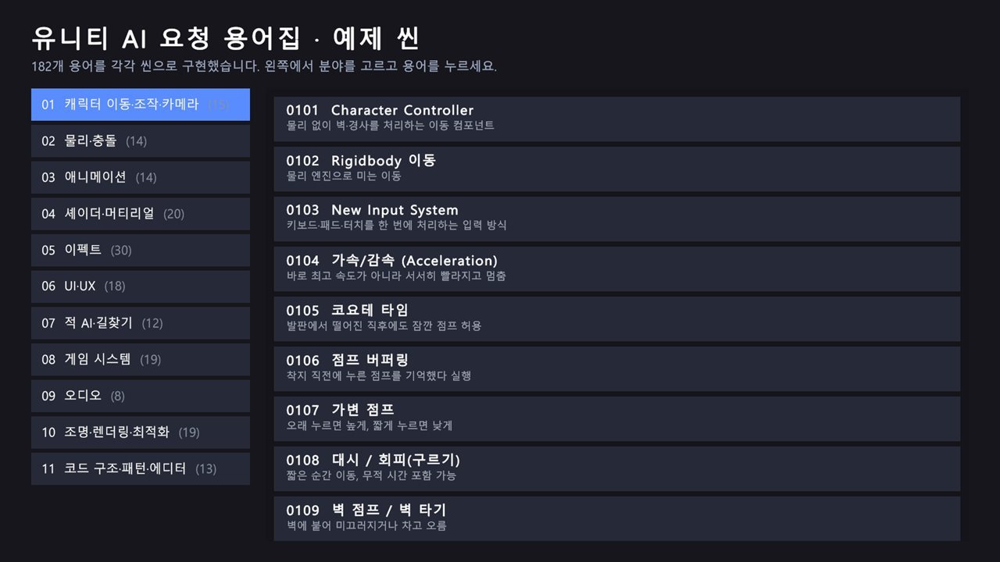
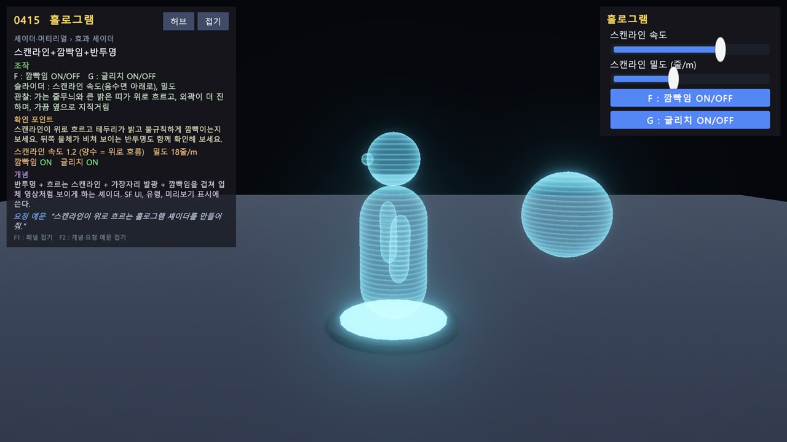
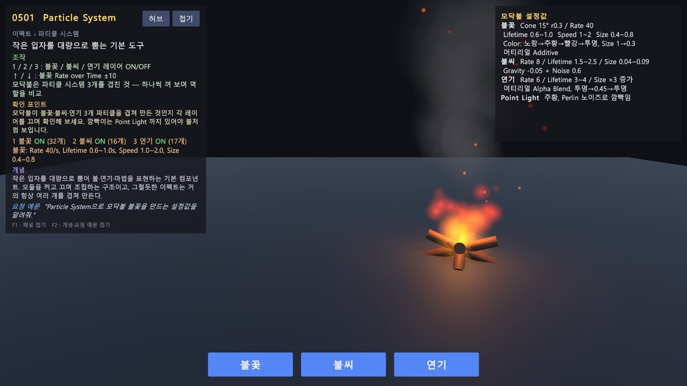
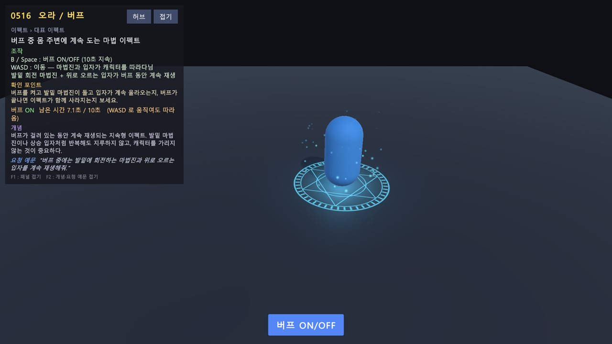
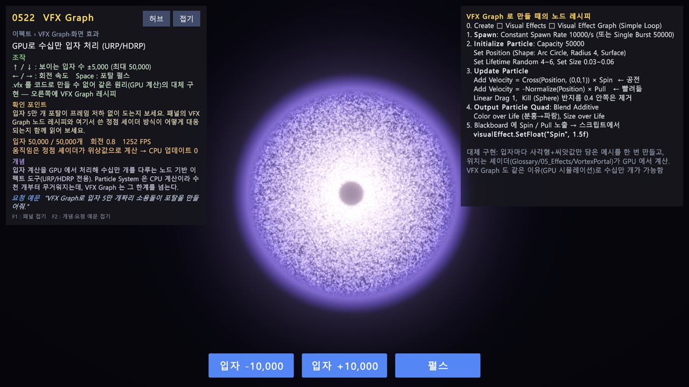
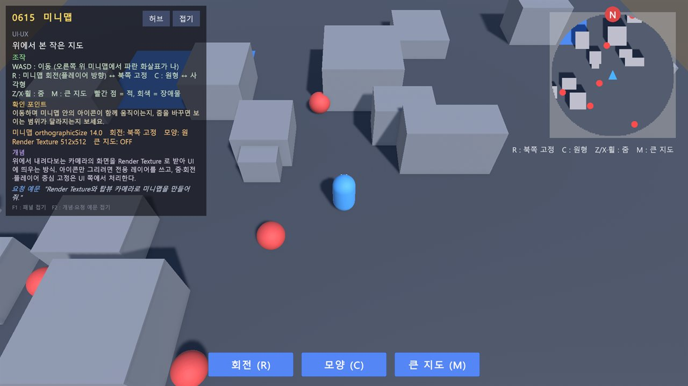
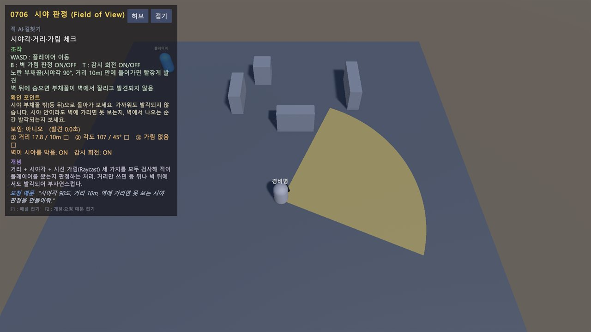
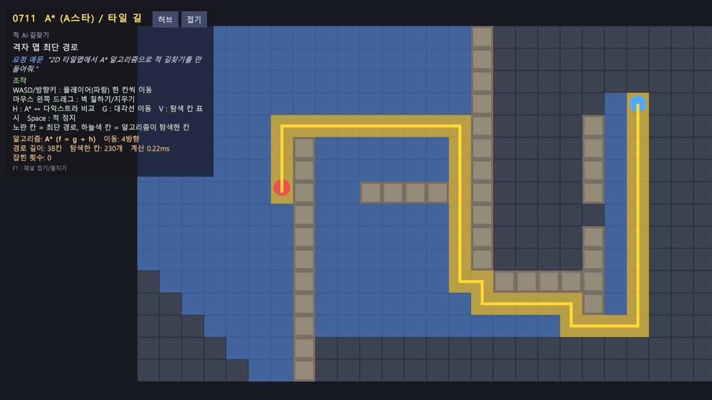
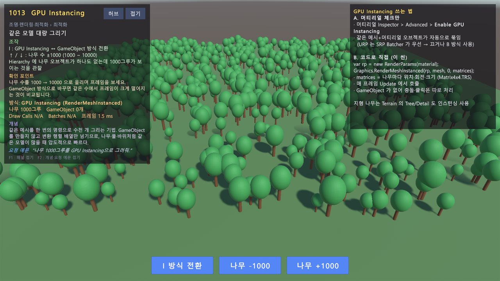

# Unity-AI-Glossary-Playground

"유니티 AI 요청 용어집"의 182개 용어를 하나씩 **동작하는 예제 씬**으로 만든 학습용 프로젝트입니다.
각 씬은 용어집의 "이렇게 요청하세요" 예문을 그대로 구현한 결과물이고, 대부분 켜기/끄기 비교로 차이를 보여 줍니다.

- Unity 6000.6.4f1, URP 17.6, New Input System, Cinemachine 6.6, AI Navigation 2.0, Timeline
- 씬 182개 + 허브 씬 1개 (+ 0816 보조 씬 2개)
- 구현 방식: 런타임 데모 163 · 설명 + 대체 구현 14 · 에디터 도구 데모 5
- 용어별 설명·씬·스크립트 정리: [Wiki](https://github.com/jes79/Unity-AI-Glossary-Playground/wiki) (원본은 `docs/wiki/`)



## 스크린샷

모든 씬 왼쪽 위에 용어 · 쉽게 말하면 · 요청 예문 · 조작법 · 실시간 상태를 보여 주는 정보 패널이 있습니다.

| | |
| --- | --- |
|  |  |
| **0415 홀로그램** · 위로 흐르는 스캔라인 셰이더 | **0501 Particle System** · 불꽃·불씨·연기 3레이어 모닥불 |
|  |  |
| **0516 오라 / 버프** · 회전 마법진 + 상승 입자 | **0522 VFX Graph** · GPU 입자 5만 개 소용돌이 포탈 |
|  |  |
| **0615 미니맵** · 탑뷰 카메라 + Render Texture | **0706 시야 판정** · 시야각 90°·10m, 벽에 가리면 못 봄 |
|  |  |
| **0711 A\*** · 타일맵 최단 경로와 탐색 칸 | **1013 GPU Instancing** · GameObject 없이 나무 1000그루 |

## 처음 열 때

1. Unity Hub에서 `Unity-AI-Glossary-Playground` 폴더를 엽니다.
2. 메뉴 `Tools > Glossary > Build All Scenes`를 실행합니다. 씬과 생성 에셋을 코드로 다시 만들고, Build Settings에 등록합니다.
   (한글 폰트는 Windows의 맑은 고딕을 복사해 TMP 동적 폰트로 만듭니다. 재배포 문제로 `malgun.ttf`는 git에 올리지 않습니다.)
3. `Assets/00_Scenes/0000_Hub.unity`를 열고 Play → 왼쪽에서 분야, 오른쪽에서 용어를 고르면 해당 씬으로 이동합니다.

각 씬 왼쪽 위 정보 패널에 **용어 · 쉽게 말하면 · 요청 예문 · 조작법 · 실시간 상태**가 표시됩니다. `F1`로 접고, `[허브]`로 돌아갑니다.

## 분야

| 번호 | 분야 | 씬 수 | 폴더 |
| --- | --- | --- | --- |
| 01 | 캐릭터 이동·조작·카메라 | 15 | `01_Movement` |
| 02 | 물리·충돌 | 14 | `02_Physics` |
| 03 | 애니메이션 | 14 | `03_Animation` |
| 04 | 셰이더·머티리얼 | 20 | `04_Shader` |
| 05 | 이펙트 (파티클·대표 이펙트·포스트 프로세싱) | 30 | `05_Effects` |
| 06 | UI·UX | 18 | `06_UI` |
| 07 | 적 AI·길찾기 | 12 | `07_EnemyAI` |
| 08 | 게임 시스템 | 19 | `08_Systems` |
| 09 | 오디오 | 8 | `09_Audio` |
| 10 | 조명·렌더링·최적화 | 19 | `10_Rendering` |
| 11 | 코드 구조·패턴·에디터 | 13 | `11_Patterns` |

씬 이름 규칙: `{분야2자리}{순번2자리}_{Name}` (예: `0105_CoyoteTime`). 전체 목록은 `Assets/01_Scripts/Common/GlossaryCatalog.Data.cs`.

## 구조

```
Assets/
  00_Scenes/{분야}/            빌더가 생성한 씬
  01_Scripts/Common/           카탈로그, 정보 패널, 허브, DemoInput, Ease
  01_Scripts/{분야}/           런타임 데모 스크립트 (네임스페이스 GlossaryDemo.*)
  01_Scripts/Editor/           GlossaryKit(씬 빌더 헬퍼), GlossaryValidator
  01_Scripts/Editor/Scenes/    씬 빌더 Build{id}_{Name}.cs
  02_Shaders/{분야}/           URP HLSL 셰이더
  04_Materials, 05_Sprites, 08_Audio, 09_Generated   빌더가 만드는 에셋 (텍스처·사운드도 코드로 생성)
docs/CONVENTIONS.md            새 씬을 추가할 때 지킬 규칙
tools/compile-check/           Unity 없이 C# 컴파일 검사 (dotnet)
```

## 도구 메뉴

- `Tools > Glossary > Build All Scenes` / `Build Scene > …` : 전체 또는 씬 하나 다시 만들기
- `Tools > Glossary > Validate All Scenes` : 셰이더 컴파일 오류, Missing Script, 분홍 머티리얼 점검
- `Tools > Glossary > Rendering/Patterns > …` : 라이트맵·오클루전 굽기, 적 스포너 창 등 데모용 에디터 도구
- `Tools > Glossary > Build Screenshot Player` : README 스크린샷용 Windows 플레이어 빌드
  (`Builds/Screenshots/Glossary.exe -glossaryShots <폴더> -glossaryShotList 0000_Hub,0415_Hologram` 로 실행하면 자동 캡처 후 종료)

명령줄 일괄 생성 + 점검:

```
Unity.exe -batchmode -projectPath Unity-AI-Glossary-Playground -executeMethod GlossaryBatch.BuildAndValidate -quit
```

## 대체 구현한 항목

설치하지 않은 패키지나 코드로 만들기 어려운 에셋은 같은 개념을 직접 구현하고, 실제 사용법을 씬 안 패널로 설명합니다.

| id | 용어 | 대체 방식 |
| --- | --- | --- |
| 0308 / 0309 | Humanoid 리타게팅 / IK | 본 이름 매핑 리타게터, 2본 IK 직접 구현 (사람형 모델 없음) |
| 0311 | 2D 본 애니메이션 | SpriteRenderer 계층 본 (2D Animation 패키지 없음) |
| 0313 | DOTween | 미니 트윈 (DOTween 없음) |
| 0402 | Shader Graph | 노드 레시피 + 같은 결과의 HLSL |
| 0520 | Decal | URP DecalProjector ↔ Quad 대체 전환 |
| 0522 | VFX Graph | 정점 셰이더로 그린 입자 5만 개 포탈 |
| 0604 | TMP 한글 폰트 | 동적 폰트 아틀라스 시연 + Font Asset Creator 단계 |
| 0819 | Localization | 문자열 테이블로 KO/EN 전환 |
| 0903 / 0907 | Audio Mixer / 스냅샷 | 스크립트 믹서 그룹, AudioLowPassFilter |
| 1009 | URP 2D Light | 라이트 맵 Render Texture + Multiply |
| 1018 | Addressables | Resources.LoadAsync |
| 1112 | Git | 미니 Git 시뮬레이터 + 설정 검사 |

## 검증 상태

- **에디터 점검**: 182개 씬 일괄 생성 + `Validate All Scenes`(셰이더 컴파일 오류·Missing Script·분홍 머티리얼) 통과
- **실행 점검**: Windows 플레이어로 185개 씬(보조 씬 포함)을 차례로 실행해 예외 로그와 화면을 확인했습니다.
  이때 찾은 문제(0417 물 셰이더 거품, 0819 문자열 테이블 연결 누락, 1011 씬 전환 멈춤, 0212 키네마틱 경고, 0604·0410 글자 겹침, 정보 패널 제목 잘림)는 모두 고쳤습니다.
- **자동 실행으로는 확인할 수 없는 부분** (키·마우스 조작이 필요한 연출):
  타격·폭발·디졸브처럼 눌러야 시작되는 연출, Cinemachine 카메라 조작감(0111~0113), 래그돌 쓰러짐(0212), Root Motion 구르기(0307)

## 주의할 점

- 0520: 씬에 있는 동안만 `QualitySettings.renderPipeline`을 Decal 복제 파이프라인으로 바꿉니다. 비정상 종료 시 Quality 설정의 파이프라인을 `PC_RPAsset`으로 되돌리세요.
- 1004 / 1012: Play 중 URP 에셋 값(그림자 거리, SRP Batcher)을 바꾸고 종료 시 되돌립니다.
- 0204: `Physics.IgnoreLayerCollision`을 실행 중에만 바꾸고 씬 종료 시 복원합니다.
- 0527 등 Depth of Field: 에디터에서는 동작하지만, 빌드에서는 URP가 DOF 셰이더를 제외해 효과가 빠질 수 있습니다.
